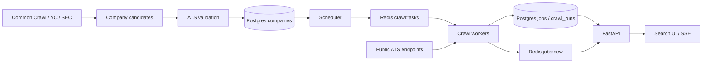

# JobRadar

JobRadar discovers company hiring boards and collects openings directly from public
Greenhouse, Lever, and Ashby endpoints. It helps candidates find US roles and apply through
company hiring pages, with a focus on new graduates and international students.

The system combines company discovery, scheduled crawling, Postgres storage, Redis Streams,
a FastAPI service, and a browser interface with live updates. Current ingestion does not
require an LLM or paid API keys.

## Features

- Company discovery from Common Crawl, YC company lists, and SEC EDGAR.
- Board validation before promotion into the crawl pipeline.
- Scalable workers, idempotent job upserts, closed listing detection, and crawl history.
- US location, state, and remote classification.
- Title and company search, 21 role categories, and new graduate and internship filters.
- Direct hiring page links and live browser updates through server sent events (SSE).
- Coverage, job counts, and detection latency metrics at `/stats`.

## Architecture



The scheduler checks for due companies every 60 seconds. Companies are polled every
15 minutes by default. Workers share a Redis consumer group and can run in parallel.
Each company's first successful crawl is a backfill and does not generate new job events.
Later inserts are published to `jobs:new` for the live feed.

## Run locally

Requirements: Docker with Docker Compose. OrbStack works on macOS.

```sh
docker compose up -d --build
docker compose run --rm api python -m app.seed
docker compose up -d --scale worker=4
```

Open [JobRadar](http://localhost:8000/) or [API documentation](http://localhost:8000/docs).
The seed contains seven companies; discovery grows coverage beyond this initial list.
Live dataset counts change, so inspect `/stats` rather than treating seed counts as coverage.

```sh
docker compose logs --tail=100 scheduler worker api
docker compose exec postgres psql -U jobradar
curl -fsS http://localhost:8000/stats
```

Application code is baked into Docker images. Rebuild affected services after code changes.

## Configuration

| Variable | Purpose | Compose default |
| --- | --- | --- |
| `DATABASE_URL` | Postgres connection | Local Compose Postgres |
| `REDIS_URL` | Redis connection | Local Compose Redis |
| `CRAWL_INTERVAL_MIN` | Time between company crawls | `15` |
| `SEC_USER_AGENT` | Name and contact email for SEC requests | Set explicitly when collecting SEC data |

Compose declares the first three values in `docker-compose.yml`; edit that configuration
or supply an override to change them. An exported shell value alone does not replace them.

## API

| Endpoint | Purpose |
| --- | --- |
| `GET /jobs` | Active jobs with text, company, category, state, location, remote, level, and time filters |
| `GET /jobs/stream` | SSE feed of newly discovered jobs after connection |
| `GET /companies?q=str` | Company name suggestions |
| `GET /categories` | Role category IDs and labels |
| `GET /states` | State counts within a discovery time window |
| `GET /stats` | Coverage, active jobs, new discoveries, and latency |

```sh
curl -fsS 'http://localhost:8000/jobs?state=NJ&hours=168&limit=10'
curl -fsS 'http://localhost:8000/jobs?category=software&company=Stripe'
curl -N http://localhost:8000/jobs/stream
```

## Validation

```sh
docker compose build api
docker compose run --rm --no-deps api python -m unittest discover -s tests -v
docker run --rm -v "$PWD":/src -w /src ghcr.io/astral-sh/ruff:0.6.9 check .
```

The suite covers discovery responses, slug parsing, candidate promotion orchestration,
category rules, and filter construction. HTTP and database interactions are mocked;
these tests do not establish live source availability or full database integration.

## Database maintenance

`db/schema.sql` initializes fresh databases only. For existing databases, add and apply
numbered SQL migrations under `db/migrations/`, and mirror changes in `schema.sql`.
For example, apply the existing location migration with:

```sh
docker compose exec -T postgres psql -U jobradar < db/migrations/002_location.sql
```

After changing location rules, rebuild and recompute existing records:

```sh
docker compose build api
docker compose run --rm api python -m app.backfill_location
```

`docker compose down -v` deletes the database volume and its data.

## Implementation notes

- Inflight Redis keys prevent duplicate scheduling and expire after 600 seconds.
- Job uniqueness is `(company_id, ext_id)`. Upsert and deactivation must share a
  transaction because deactivation depends on the same Postgres `now()` value.
- Workers log each crawl in `crawl_runs`. Redis reads use timeouts and retry handling.
- Lever slugs preserve case; discovery lowercases Greenhouse and Ashby slugs.
- Add an ATS fetcher in `app/fetchers.py` returning `ext_id`, `title`, `location`,
  `url`, `posted_at`, and `raw`. Register its key in `FETCHERS`, add a discovery
  probe, and register supported board hosts in `CC_HOSTS`.

## Current limitations

- Coverage is limited to discovered companies and supported ATS providers.
- UI time windows use `first_seen`, when JobRadar discovered a job, rather than its posting date.
- ATS dates can represent updates rather than original publication. Detection latency is
  an approximation and is not a guaranteed freshness measurement.
- Browser updates stream after discovery; source polling is not instantaneous.
- Location, role category, and seniority rules can misclassify or miss listings.
  Unknown US locations are hidden by the default US filter.
- Live inserts are currently skipped when a level filter is selected; reload to see matches.
- Worker recovery for abandoned pending tasks and strict crawl rate limiting remain planned.
- Redis has no persistent volume in the local Compose configuration.

## Deployment

The API, scheduler, workers, Postgres, and Redis must all be hosted for a complete public
service. Deploying just the HTML leaves the data pipeline on the local computer.
A hosted container platform or a server running Docker Compose can support this architecture.

The current Compose file is intended for local development. Public deployment requires
private database networking, new credentials, persistent storage, backups, HTTPS, and
resource monitoring. Do not expose the local Postgres and Redis ports publicly.

## Roadmap

1. Expand verified company discovery and add Workday and SmartRecruiters.
2. Improve location accuracy, posting date semantics, worker recovery, and rate limiting.
3. Add email alerts and measure coverage and detection latency.
4. Build duplicate detection, O*NET title normalization, skill and seniority extraction,
   and a sponsorship predictor using public Department of Labor LCA data.
5. Add hybrid search, reranking, resume matching, and relevance evaluation.
6. Add agent workflows and ML monitoring as the underlying data and evaluations mature.

## Company discovery architecture

- `app/discovery/sources.py` owns collection and slug normalization. Common Crawl supplies observed board URLs; YC and SEC supply company names used to generate guesses for each supported ATS. These sources do not guarantee US coverage; job location filtering happens after crawling.
- `app/discovery/__main__.py` writes candidates in batches of 1,000. The `(ats, slug)` unique key makes repeated collection safe. Counts report candidates offered, not newly inserted rows. The first source retained for a candidate is its provenance.
- `app/discovery/probe.py` validates batches of 500 with a separate concurrency semaphore for each ATS. A semaphore caps simultaneous requests; this is not a strict requests per second rate limit. Each request also has a short pacing delay.
- Probe states are `pending`, `valid`, `empty`, `invalid`, `mismatch`, and `error`. Only `valid` boards are promoted. Candidate updates and company promotion share a transaction. Malformed responses become `error` without aborting the batch.
- Greenhouse guessed names are compared with the board name. Lever and Ashby lack this identity check, so guessed matches remain a known source of false positives. State registry collection is not implemented yet.
- A probe run captures its start time so retries visit each candidate at most once during that run. Concurrent probe processes are not coordinated; run one probe process at a time.

Start with a bounded discovery run:

```sh
docker compose build api
docker compose run --rm api python -m app.discovery collect commoncrawl --crawls 1 --max-pages 1
docker compose run --rm api python -m app.discovery probe --source commoncrawl --limit 100 --concurrency 4
docker compose run --rm api python -m app.discovery stats
```

Retry transient failures or revisit empty boards with `probe --retry error,empty --limit 100`.
For SEC collection, pass the contact header into the container explicitly:
`docker compose run --rm -e SEC_USER_AGENT='JobRadar your@email.com' api python -m app.discovery collect sec`.
The scheduler automatically picks up promoted companies for their first backfill.

## Job categories

`app/categories.py` owns title rules for role families such as AI/ML, software, data analysis,
healthcare, and trades. A job can match multiple categories. These describe the role rather
than the employer industry. They are rule based and can miss unusual titles; they are not an ML classifier.
`GET /categories` lists category IDs and labels. `/jobs?category=ai_ml` combines the category
with existing filters in SQL before pagination. Both `/jobs` and SSE payloads include `categories`
so the UI applies the same category rules to incoming jobs. Existing jobs work immediately,
without a schema change or backfill. Add patterns compatible with Python and PostgreSQL regexes.
Run the full test suite with the unittest command in Validation.

`/jobs?company=Stripe` adds a separate company name filter. `/companies?q=str` supplies
company name suggestions from active companies, capped at 100 results. The UI combines
company search with category, title, location, and level filters.
