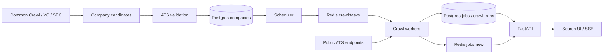

# JobRadar

JobRadar discovers company hiring boards and collects openings directly from public
Greenhouse, Lever, Ashby, SmartRecruiters, and Amazon careers endpoints. It helps candidates find US roles and apply through
company hiring pages, with a focus on new graduates and international students.

The system combines company discovery, scheduled crawling, Postgres storage, Redis Streams,
a FastAPI service, and a browser interface with live updates. Current ingestion does not
require an LLM or paid API keys.

## Features

- Company discovery from Common Crawl, YC company lists, and SEC EDGAR, plus validated careers URL intake.
- Board validation before promotion into the crawl pipeline.
- Scalable workers, idempotent job upserts, closed listing detection, and crawl history.
- US location, state, and remote classification.
- Title and company search, 21 role categories, and new graduate and internship filters.
- Direct hiring page links and live browser updates through server sent events (SSE).
- Coverage, job counts, and detection latency metrics at `/stats`.

## Architecture



The scheduler checks for due companies every 60 seconds. Companies are polled every
15 minutes by default. Workers share a Redis consumer group and can run in parallel.
Each company's first successful crawl is a backfill and does not generate new job events.
Later inserts are published to `jobs:new` for the live feed.

## Run locally

Requirements: Docker with Docker Compose. OrbStack works on macOS.

```sh
docker compose up -d --build
docker compose run --rm api python -m app.seed
docker compose up -d --scale worker=4
```

Open [JobRadar](http://localhost:8000/) or [API documentation](http://localhost:8000/docs).
The seed contains seven companies; discovery grows coverage beyond this initial list.
Live dataset counts change, so inspect `/stats` rather than treating seed counts as coverage.

```sh
docker compose logs --tail=100 scheduler worker api
docker compose exec postgres psql -U jobradar
curl -fsS http://localhost:8000/stats
```

Application code is baked into Docker images. Rebuild affected services after code changes.

## Configuration

| Variable | Purpose | Compose default |
| --- | --- | --- |
| `DATABASE_URL` | Postgres connection | Local Compose Postgres |
| `REDIS_URL` | Redis connection | Local Compose Redis |
| `CRAWL_INTERVAL_MIN` | Time between company crawls | `15` |
| `SEC_USER_AGENT` | Name and contact email for SEC requests | Set explicitly when collecting SEC data |

Compose declares the first three values in `docker-compose.yml`; edit that configuration
or supply an override to change them. An exported shell value alone does not replace them.

## API

| Endpoint | Purpose |
| --- | --- |
| `GET /jobs` | Active jobs with text, company, category, state, location, remote, level, and time filters |
| `GET /jobs/stream` | SSE feed of newly discovered jobs after connection |
| `GET /companies?q=str` | Company name suggestions |
| `GET /categories` | Role category IDs and labels |
| `GET /states` | State counts within a discovery time window |
| `GET /stats` | Coverage, active jobs, new discoveries, and latency |

```sh
curl -fsS 'http://localhost:8000/jobs?state=NJ&hours=168&limit=10'
curl -fsS 'http://localhost:8000/jobs?category=software&company=Stripe'
curl -N http://localhost:8000/jobs/stream
```

## Validation

```sh
docker compose build api
docker compose run --rm --no-deps api python -m unittest discover -s tests -v
docker run --rm -v "$PWD":/src -w /src ghcr.io/astral-sh/ruff:0.6.9 check .
```

The suite covers discovery responses, slug parsing, candidate promotion orchestration,
category rules, and filter construction. HTTP and database interactions are mocked;
these tests do not establish live source availability or full database integration.

## Database maintenance

`db/schema.sql` initializes fresh databases only. For existing databases, add and apply
numbered SQL migrations under `db/migrations/`, and mirror changes in `schema.sql`.
For example, apply the existing location migration with:

```sh
docker compose exec -T postgres psql -U jobradar < db/migrations/002_location.sql
```

After changing location rules, rebuild and recompute existing records:

```sh
docker compose build api
docker compose run --rm api python -m app.backfill_location
```

`docker compose down -v` deletes the database volume and its data.

## Implementation notes

- Inflight Redis keys prevent duplicate scheduling and expire after 600 seconds.
- Job uniqueness is `(company_id, ext_id)`. Upsert and deactivation must share a
  transaction because deactivation depends on the same Postgres `now()` value.
- Workers log each crawl in `crawl_runs`. Redis reads use timeouts and retry handling.
- Lever slugs preserve case; discovery lowercases Greenhouse and Ashby slugs.
- Add an ATS fetcher in `app/fetchers.py` returning `ext_id`, `title`, `location`,
  `url`, `posted_at`, and `raw`. Register its key in `FETCHERS`, add a discovery
  probe, and register supported board hosts in `CC_HOSTS`.

## Current limitations

- Coverage is limited to discovered companies and supported ATS providers.
- UI time windows use `first_seen`, when JobRadar discovered a job, rather than its posting date.
- ATS dates can represent updates rather than original publication. Detection latency is
  an approximation and is not a guaranteed freshness measurement.
- Browser updates stream after discovery; source polling is not instantaneous.
- Location, role category, and seniority rules can misclassify or miss listings.
  Unknown US locations are hidden by the default US filter.
- Live inserts are currently skipped when a level filter is selected; reload to see matches.
- Worker recovery for abandoned pending tasks and strict crawl rate limiting remain planned.
- Redis has no persistent volume in the local Compose configuration.

## Deployment

The API, scheduler, workers, Postgres, and Redis must all be hosted for a complete public
service. Deploying just the HTML leaves the data pipeline on the local computer.
A hosted container platform or a server running Docker Compose can support this architecture.

The current Compose file is intended for local development. Public deployment requires
private database networking, new credentials, persistent storage, backups, HTTPS, and
resource monitoring. Do not expose the local Postgres and Redis ports publicly.

## Roadmap

1. Expand verified company discovery and add Workday and more custom careers adapters.
2. Improve location accuracy, posting date semantics, worker recovery, and rate limiting.
3. Add email alerts and measure coverage and detection latency.
4. Build duplicate detection, O*NET title normalization, skill and seniority extraction,
   and a sponsorship predictor using public Department of Labor LCA data.
5. Add hybrid search, reranking, resume matching, and relevance evaluation.
6. Add agent workflows and ML monitoring as the underlying data and evaluations mature.

## Company discovery architecture

- `app/discovery/sources.py` owns collection and slug normalization. Common Crawl supplies observed board URLs; YC and SEC supply company names used to generate guesses for each supported ATS. These sources do not guarantee US coverage; job location filtering happens after crawling.
- `app/discovery/__main__.py` writes candidates in batches of 1,000. The `(ats, slug)` unique key makes repeated collection safe. Counts report candidates offered, not newly inserted rows. The first source retained for a candidate is its provenance.
- `app/discovery/probe.py` validates batches of 500 with a separate concurrency semaphore for each ATS. A semaphore caps simultaneous requests; this is not a strict requests per second rate limit. Each request also has a short pacing delay.
- Probe states are `pending`, `valid`, `empty`, `invalid`, `mismatch`, and `error`. Only `valid` boards are promoted. Candidate updates and company promotion share a transaction. Malformed responses become `error` without aborting the batch.
- Greenhouse guessed names are compared with the board name. Lever and Ashby lack this identity check, so guessed matches remain a known source of false positives. State registry collection is not implemented yet.
- A probe run captures its start time so retries visit each candidate at most once during that run. Concurrent probe processes are not coordinated; run one probe process at a time.

Start with a bounded discovery run:

```sh
docker compose build api
docker compose run --rm api python -m app.discovery collect commoncrawl --crawls 1 --max-pages 1
docker compose run --rm api python -m app.discovery probe --source commoncrawl --limit 100 --concurrency 4
docker compose run --rm api python -m app.discovery stats
```

Retry transient failures or revisit empty boards with `probe --retry error,empty --limit 100`.
For SEC collection, pass the contact header into the container explicitly:
`docker compose run --rm -e SEC_USER_AGENT='JobRadar your@email.com' api python -m app.discovery collect sec`.
The scheduler automatically picks up promoted companies for their first backfill.

## Job categories

`app/categories.py` owns title rules for role families such as AI/ML, software, data analysis,
healthcare, and trades. A job can match multiple categories. These describe the role rather
than the employer industry. They are rule based and can miss unusual titles; they are not an ML classifier.
`GET /categories` lists category IDs and labels. `/jobs?category=ai_ml` combines the category
with existing filters in SQL before pagination. Both `/jobs` and SSE payloads include `categories`
so the UI applies the same category rules to incoming jobs. Existing jobs work immediately,
without a schema change or backfill. Add patterns compatible with Python and PostgreSQL regexes.
Run the full test suite with the unittest command in Validation.

`/jobs?company=Stripe` adds a separate company name filter. `/companies?q=str` supplies
company name suggestions from active companies, capped at 100 results. The UI combines
company search with category, title, location, and level filters.

## Careers coverage and adding companies

Coverage is built source by source; arbitrary company careers pages are not automatically
supported. Use the Company field to see whether a company is indexed, awaiting its initial
crawl, or experiencing errors. `/coverage?company=Amazon` reports this independently of
job filters. A missing company means a coverage gap, not that it has no openings.

Add a supported public careers URL after rebuilding the API and workers:

```sh
docker compose build api worker
docker compose run --rm api python -m app.discovery add https://www.amazon.jobs/en/ --name Amazon
docker compose run --rm api python -m app.discovery add https://careers.smartrecruiters.com/BoschGroup --name 'Bosch Group'
```

The command recognizes supported board hosts, probes the source, and promotes only a board
with open jobs. Unsupported URLs are rejected explicitly rather than added as broken companies.
SmartRecruiters hosts are included in Common Crawl discovery. Workday and other custom
careers platforms still need adapters; this does not establish coverage of every employer.

`app/career_fetchers.py` adds paginated SmartRecruiters collection and Amazon's public,
undocumented website search endpoint. The latter can change without notice. Amazon polling
uses `country=USA`, sorts recent, and reads at most 1,000 results per crawl. It is partial
coverage, and date precision is one day. Historical openings beyond that window are not
backfilled. Partial feeds never deactivate unseen jobs, so their closure status can become
stale until a separate verification pass is implemented. Pagination failures are crawl errors,
not successful empty snapshots. Full SmartRecruiters snapshots retain normal closure detection.
Workers update stored raw payloads when refreshing postings.

Source references:
- [SmartRecruiters Posting API](https://developers.smartrecruiters.com/reference/v1listpostings)
- [Amazon careers search](https://www.amazon.jobs/en/search)

The public Quick Tunnel and ngrok free demo domains use a 60 second page refresh instead of SSE. Its URL is
temporary and the Mac and Docker must remain running. If an automated client receives a
403, capture the response body and Cloudflare headers: the application has no API authentication
or bot block, but an intermediary may reject individual clients. The running tunnel is outside
Compose; stop it with `docker stop jobradar-public-direct`.

## Alternative public route for automated clients

The accountless Cloudflare Quick Tunnel has no zone firewall dashboard under this project.
A client specific 403 cannot be fixed by adding application CORS headers or changing a
User-Agent. Use the optional ngrok route to test a different public ingress provider while
keeping the existing link running. This is still hosted on the Mac, not an independent server.

1. Create a free account at [ngrok](https://dashboard.ngrok.com/signup).
2. Obtain your authtoken from its dashboard. Add `NGROK_AUTHTOKEN=your_token` to the local
   `.env` file, preserving any existing entries. This file is ignored by Git. Never post the token.
3. Start just the optional tunnel:

```sh
docker compose -f docker-compose.yml -f docker-compose.public.yml up -d --no-deps ngrok
docker compose -f docker-compose.yml -f docker-compose.public.yml logs --tail=30 ngrok
```

The startup log provides the HTTPS address. API clients should send
`ngrok-skip-browser-warning: 1` when requesting `/jobs` and `/stats`; humans may see ngrok's
free plan browser notice. Verify the route from the actual automated client before assuming
the egress problem is resolved. API responses include `X-JobRadar-Origin: api`, which helps
distinguish application responses from upstream rejection pages.

The free plan currently includes 1 GB monthly outbound traffic and 20,000 HTTP requests.
It is suitable for a small demo, not unrestricted daily crawling of the entire database.
Check [current limits](https://ngrok.com/docs/pricing-limits/free-plan-limits) before use.
Stop the alternate route with:

```sh
docker compose -f docker-compose.yml -f docker-compose.public.yml stop ngrok
```

## Frontend layout

The responsive interface lives in `app/static/index.html`, `styles.css`, and `app.js`.
FastAPI serves assets under `/static`. Desktop uses a scrollable sticky filter sidebar;
phones use a collapsed filter panel and stacked job cards. Controls keep their labels,
keyboard focus indicators, and at least 16px input text on phones to avoid automatic zoom.
The page keeps a white background regardless of system theme and respects reduced motion preferences.
Search has request ordering protection, loading and error states, reset controls, and
company coverage messages. Role category shortcuts reuse the existing API filters.
No frontend build process or external fonts are required.

### Posting evidence and detection measurements

`/jobs` now includes `salary`, `sponsorship`, `opt`, and `signals`. Evidence comes from the
posting and includes its source URL. Sponsorship status is `offered`, `not_offered`,
`conflicting`, or `unknown`; OPT mentions do not establish eligibility. Missing salary
currency or interval remains null. Filters: `sponsorship=offered`, `opt_mentioned=true`,
`salary_disclosed=true`. Coverage depends on the source exposing description/compensation.
Greenhouse requests full content and Ashby requests compensation on subsequent crawls.
Backfill existing raw data with `python -m app.backfill_signals` inside the API container.

The crawl interval defaults to 5 minutes (override `CRAWL_INTERVAL_MIN`).
`median_detect_minutes` remains the legacy posting-age metric, also explicitly named
`median_posting_age_at_detection_minutes`. It includes upstream timestamp delays.
`median_observation_gap_minutes` measures the upper bound since the preceding successful
complete feed crawl for newly observed jobs over 24 hours, with `observation_gap_samples`.
It excludes partial Amazon feeds and cannot reconstruct old observation bounds.

The ngrok overlay pins the existing account domain; override `NGROK_URL` for another
account. Free ngrok still requires the Mac and Docker to run and presents a browser
notice; automated callers use request header `ngrok-skip-browser-warning: 1`.
This is public tunneling, not independent permanent hosting.

Description screening: `/jobs` includes `requirements.findings` with verbatim evidence
for experience, doctoral degree mentions, work authorization restrictions, enrollment,
and graduation windows. `requirement=experience|doctoral_degree|work_authorization|enrollment|graduation_window`
filters for those mentions. The UI exposes the same review filters and evidence.
Preferences and alternatives are marked where detected; these rule-based flags are not
personal eligibility decisions. Missing findings or missing descriptions mean unknown,
not qualified. Title-based `level=newgrad` remains a discovery filter, not JD screening.

`/jobs?sponsorship=exclude_denied` excludes explicit denials while keeping unknowns and
conflicting evidence available for review. `salary_disclosed=true` also includes fixed
salary amounts (`kind=fixed`, min equals max); missing currency/period stays unknown.
OPT/CPT flags only identify mentions, not employer acceptance or authorization eligibility.

The `descriptions` service fetches up to 20 missing US SmartRecruiters descriptions per
minute with a half-second pause between requests, independently of the discovery workers.
It updates posting evidence without changing first_seen or publishing new-job events.
The API has `/health`; the public tunnel waits for healthy startup. A pinned ngrok address
and readiness checks do not provide uptime while the host Mac is offline.

### Private application sync and hunt filters

The page's **Mark applied** button creates a private workspace. **Sync private application
history → Copy sync token** lets your other browser or tools connect to the same history.
Keep that token private; it grants access to your application records. Public visitors do
not see your application state. History persists in PostgreSQL across app/tunnel restarts.

API sequence:
- `POST /workspaces` returns a workspace ID and secret token (save it securely).
- Send `Authorization: Bearer <token>` on private requests.
- `POST /applications` accepts one object or an array (up to 1000):
  `{"company":"Example","title":"Data Analyst","url":"https://example.com/jobs/123"}`.
  Optional `applied_at` records the original application time. Repeated URL sync is idempotent.
- `GET /applications` exports your records; `before_id` paginates past 1000.
- `DELETE /applications/{id}` undoes a mark, only in your workspace.
- `/jobs?applied=exclude` hides matched applications; `applied=only` returns them.
  Tracking parameters are ignored but meaningful job IDs are preserved. Same-company/title
  matches with different URLs are marked `previously_applied_similar` for review, not silently hidden.

`/jobs?min_comp=70000&comp_interval=year&comp_currency=USD` excludes jobs whose maximum
comparable annual pay is below the floor. For interns, use `min_comp=25&comp_interval=hour`.
Unknown currency/period stays visible by default; `keep_unknown_pay=false` requests only
comparable disclosed pay. No guessed conversion between hourly and annual pay.

`level=entry_body` finds explicit early-career/0–2 years evidence in descriptions and
excludes senior titles. Conflicting higher-experience requirements are labeled for review.
`entry_level` includes evidence; `start_dates` includes explicit employment start dates,
with day/month precision. `available_from=2027-03-01` excludes known earlier starts while
retaining unstated dates and ambiguous month-only dates for review.

Sponsor history is separate from JD sponsorship. Import reviewed JSON records with
`docker compose run --rm api python -m app.history_import data/history.json`:
`[{"company_id":123,"fiscal_year":2025,"filings_count":10,"record_type":"lca_filings",
"source_url":"https://www.dol.gov/agencies/eta/foreign-labor/performance","employer_name":"Exact legal employer"}]`.
Use `/coverage?company=...` to find company IDs and explicitly review employer aliases.
Allowed record types: `lca_filings`, `petition_approvals`, `user_ranked_history`.
No record means unknown; LCA filings are not visa approvals or a job sponsorship promise.
`/jobs?sponsor_history_only=true` filters to recorded positive counts.

`reactivation_count` / `reactivated_at` record an observed inactive-to-active transition
starting with this release; `reactivated_only=true` filters these. `possible_repost_of`
links older inactive postings with the exact same company, title and location. These are
candidates for review, not confirmed reposts, and old transitions cannot be reconstructed.

Apply migration `004_hunt_state.sql` before deploying. Run `python -m app.backfill_identity`
inside the API container once for existing URL identities. Workers refresh description
signals on normal crawls. Description enrichment covers SmartRecruiters, Greenhouse and
Lever; unavailable/empty upstream descriptions remain explicitly unknown.

Opt-in real database regression checks (use temporary tables, not real job mutations):
`docker compose run --rm --no-deps -e JOBRADAR_DB_TESTS=1 api python -m unittest discover -s tests -p test_hunt_database.py -v`.
